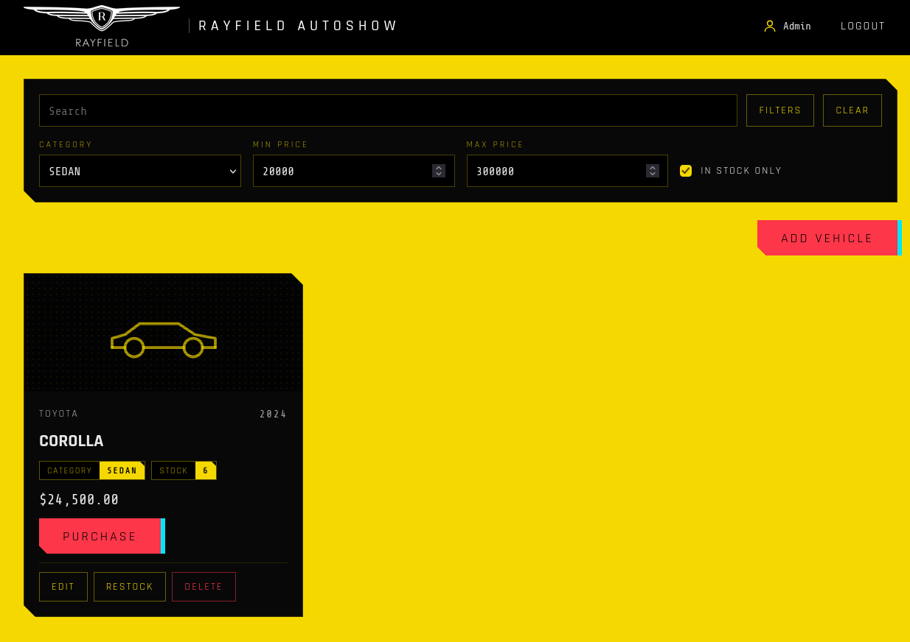
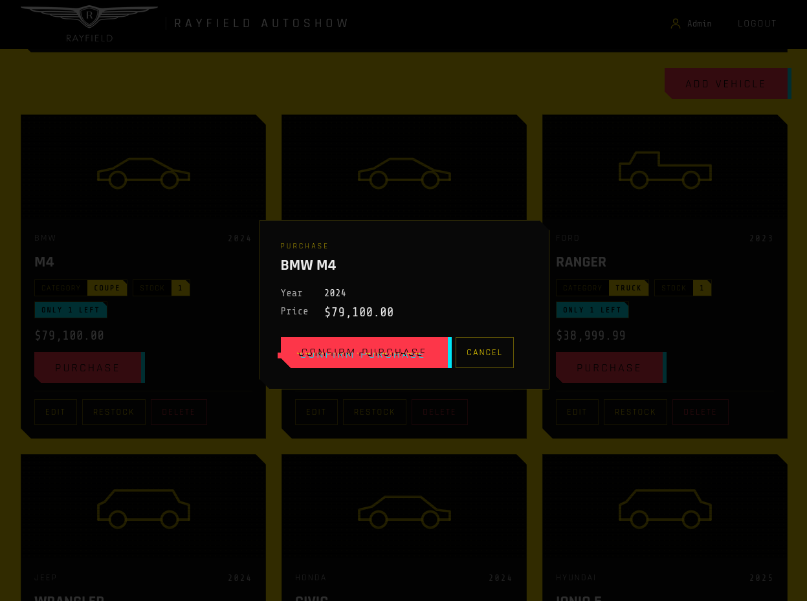
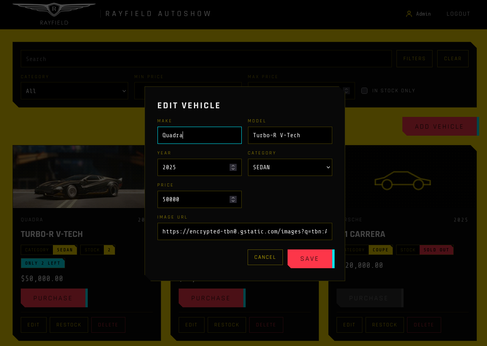
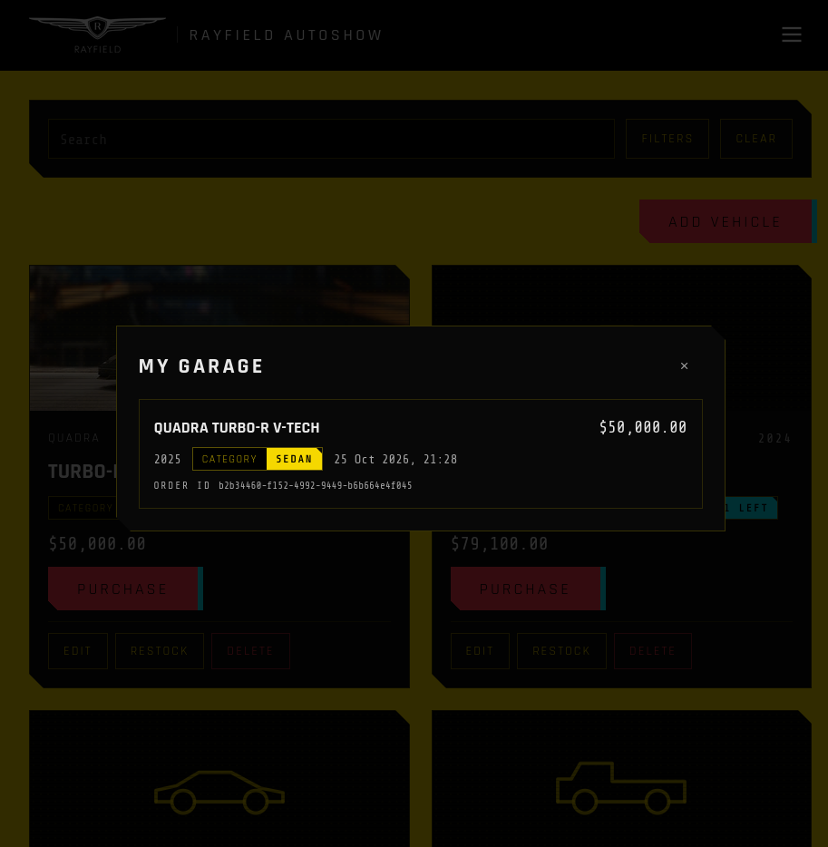

# Rayfield Autoshow

A car dealership inventory system built test-first for the Incubyte TDD kata: an Express +
TypeScript API on Postgres with its own JWT auth, and a React + Tailwind single-page app in a
cyberpunk theme. Users browse, search and buy vehicles; admins add, edit, delete and restock
them.

**Live:** https://incubyte.somvanshi.dev

| Login | Search and filters | Purchase |
|---|---|---|
|  |  |  |

| Admin: edit a vehicle | My Garage |
|---|---|
|  |  |

## Contents

- [Features](#features)
- [Try the live demo](#try-the-live-demo)
- [Tech stack](#tech-stack)
- [Design decisions](#design-decisions)
- [Architecture](#architecture)
- [API](#api)
- [Run it locally](#run-it-locally)
- [Tests](#tests)
- [Deployment](#deployment)
- [Credits](#credits)
- [My AI Usage](#my-ai-usage)

## Features

**Everyone logged in**
- Register (logs you in straight away) and log in; the session survives a reload and an expired
  token sends you back to the login page with a message.
- Inventory grid with make, model, year, category, USD price and stock; "Only N left" and
  "Sold out" badges; a category icon when a vehicle has no image (or its image fails to load).
- Live search: one search bar matches make or model as you type (debounced), with category,
  price range and "in stock only" behind a Filters button. Filters live in the URL, so a link
  or reload restores them.
- Purchase one unit through a confirmation dialog; sold-out vehicles can't be bought, and a
  double-click can't buy twice. If someone else bought the last unit first, the dialog says so
  and the card refreshes.
- My Garage: your own purchase history from the header (or the mobile menu): every unit bought,
  newest first, with what you paid, when, and an order id. It reloads each time it opens, so a
  car you just bought is there.

**Admins**
- Add, edit (full replacement), delete (with an in-page confirmation) and restock vehicles,
  on the same page; the controls only render for admins and the API enforces it too.
- Client-side validation mirrors the API's rules and messages; server errors appear under the
  matching field.

**Polish**
- Responsive from 390px phones (hamburger menu) to wide desktops (4-column grid).
- Accessible: labelled inputs, visible focus, real buttons, toasts and dialogs announced to
  screen readers, keyboard support (Escape closes dialogs, focus starts in the first field).
- Motion (boot splash, login sweep, glitch effects, wipes) is skipped for users who ask their
  OS for reduced motion.

## Try the live demo

<!-- TODO: fill in the demo accounts before submitting. -->
| Role | Email | Password |
|---|---|---|
| User | `<demo-user-email>` | `<demo-user-password>` |
| Admin | `<demo-admin-email>` | `<demo-admin-password>` |

You can also register your own account (always a regular user). The demo data is shared:
anyone can buy, add or delete vehicles. `npm run db:seed:demo` resets it to the sample set and
empties everyone's garage.

## Tech stack

| Layer | Choice |
|---|---|
| API | Node.js, Express 5, TypeScript |
| Database | PostgreSQL 17: Docker locally (dev + test), Supabase in production; Drizzle ORM + `pg` |
| Validation | Zod (one schema per request; also the source of the error messages) |
| Auth | Own JWT (`jsonwebtoken`, HS256) + `bcryptjs` |
| Frontend | React 19, Vite, React Router, Tailwind CSS v4 |
| Tests | Jest + Supertest (API, against real Postgres); Vitest + React Testing Library + user-event + MSW (UI) |
| Hosting | Vercel (two projects), custom domain |

## Design decisions

- **Own JWT auth, not a hosted auth service,** so the auth logic is part of the kata. Tokens are
  HS256 with a secret of 32+ characters; passwords use bcrypt, and a login for an unknown email
  still runs a bcrypt comparison so response time doesn't reveal which emails exist.
- **Admins are created only by a seed script** (`db:seed:admin`, from env vars), never through
  `/register`; a `role` in a request body is ignored. Re-running the seed resets the admin's
  password and role.
- **Admin-only writes:** creating, editing, deleting and restocking vehicles need the admin role;
  any logged-in user can view, search and purchase.
- **Stock only changes through purchase and restock.** Purchase is always one unit, done with a
  single conditional `UPDATE ... WHERE quantity > 0`, so two buyers can't take the last unit;
  the loser gets a 409. Each sale also records a purchase (who bought it, plus a snapshot of
  make, model, year, category and the price paid) in the same transaction, so the history can't
  disagree with the stock and survives later edits or deletion of the vehicle. Restock adds
  1–10,000. `PUT` ignores `quantity`, and is a full
  replacement of the editable fields (an omitted `imageUrl` clears the image).
- **Money is `numeric(12,2)`**, converted to a JSON number in one place (the repository). Prices
  are 0.01–100,000,000 with at most 2 decimals; display uses `Intl.NumberFormat` in USD.
- **One error format** for every failure: `{ "error": { "code", "message", "details"? } }`, with
  one `details` entry per invalid field, so the UI can show each message under its field. No
  stack traces ever reach the client; unexpected errors are logged and answered with a generic
  500. Unknown fields are stripped, malformed IDs and JSON are 400s, unknown routes are JSON 404s.
- **Search** (`GET /api/vehicles/search`): `q` matches part of the make or the model (the UI's
  single search bar), plus `make`, `model`, `category` (case-insensitive), and an inclusive price
  range; `%` and `_` match literally, blank params count as absent, filters combine with AND.
  "In stock only" is a client-side filter.
- **Validation lives on both sides:** the backend is the source of truth; the frontend copies
  the same rules and messages so most mistakes show instantly. The category list is copied too
  (`frontend/src/constants/categories.ts`, with a keep-in-sync comment), since the two apps share
  no package.
- **Token in `localStorage`:** simple and stateless, at the cost that a successful XSS could read
  it (an httpOnly cookie wouldn't allow that). Accepted for this scope: React escapes all
  rendered data and the app renders no raw HTML.
- **A 401 logs you out**, except on `/api/auth/*`, where it means wrong credentials and is shown
  on the form.
- **No rate limiting:** it would trip the auth tests, and an in-memory limit doesn't hold across
  serverless instances. Future work, along with pagination (the inventory is small).
- **Duplicates are allowed** (the same make, model and year can be different trims).
- **Database TLS in production:** `DATABASE_SSL=true` turns TLS on with
  `rejectUnauthorized: false`, because Supabase's certificate chain fails Node's strict check.
  The link is encrypted but the server isn't authenticated; the stricter fix (pinning Supabase's
  CA certificate) is noted in `backend/src/db/poolConfig.ts`.
- **One origin:** the frontend always calls relative `/api/...`; Vite proxies it locally and a
  Vercel rewrite forwards it in production, so there's no CORS setup.

## Architecture

```
Browser ──► incubyte.somvanshi.dev (Vercel, frontend: static SPA)
               │  /api/*  rewrite
               ▼
            Express API (Vercel function) ──► Postgres (Supabase)

Request path in the API:
  route ─► middleware (helmet, JSON, authenticate, requireAdmin, validate)
        ─► controller (HTTP in/out) ─► service (rules) ─► repository (all SQL, Drizzle)
  errors ─► errorHandler (one JSON format)
```

`createApp({ repos })` builds the app from its repositories, so tests drive the real app through
Supertest, and one test injects a repository that throws to check the 500 path.

```
backend/
  src/
    app.ts                   createApp({ repos }); default export for Vercel
    server.ts                local entry point (listen)
    config/                  env schema + validation (fails fast at startup)
    db/                      Drizzle schema, pool config (TLS, size), client, migrations
    lib/                     errors, password hashing, JWT
    middleware/              authenticate, requireAdmin, validate, errorHandler
    modules/auth/            routes, controller, service, schemas, users repository
    modules/vehicles/        routes, controller, service, schemas, vehicles repository, categories
    modules/purchases/       purchase history (My Garage): routes, controller, service, repository
    scripts/                 seedAdmin, seedDemo
  tests/                     auth/, vehicles/, purchases/, middleware/, scripts/, unit/, helpers/
  docker-compose.yml         db-dev (5432) and db-test (5433, tmpfs)
frontend/
  src/
    api/                     fetch client (token, error format, 401 handling), endpoints, session
    context/AuthContext.tsx  session state, login/register/logout
    components/              Header, SearchPanel, VehicleCard, Modal, PurchaseDialog, GarageDialog, ...
    pages/                   Inventory, Login, Register, NotFound
    routes/                  ProtectedRoute, GuestRoute
    validation/              client-side copies of the API's rules
    index.css                theme (Tailwind v4 tokens and components)
docs/                        PLAN.md and UI_PLAN.md (the plan and both TDD test lists, ticked
                             as built), the test report, screenshots
```

## API

All responses are JSON. Every `/api/vehicles` and `/api/purchases` endpoint needs
`Authorization: Bearer <token>`.

| Method | Path | Who | Success | Notes |
|---|---|---|---|---|
| GET | `/api/health` | anyone | 200 `{ status: "ok" }` | liveness, no DB |
| POST | `/api/auth/register` | anyone | 201 `{ id, name, email, role }` | 409 if the email is taken |
| POST | `/api/auth/login` | anyone | 200 `{ token, user }` | 401 on wrong credentials |
| GET | `/api/vehicles` | user | 200 `Vehicle[]` | newest first, sold-out included |
| GET | `/api/vehicles/search` | user | 200 `Vehicle[]` | `q`, `make`, `model`, `category`, `minPrice`, `maxPrice` |
| POST | `/api/vehicles` | admin | 201 `Vehicle` | `quantity` optional (default 0) |
| PUT | `/api/vehicles/:id` | admin | 200 `Vehicle` | full replacement; `quantity` ignored |
| DELETE | `/api/vehicles/:id` | admin | 204 | |
| POST | `/api/vehicles/:id/purchase` | user | 200 `Vehicle` | one unit; 409 when out of stock |
| POST | `/api/vehicles/:id/restock` | admin | 200 `Vehicle` | body `{ quantity }`, 1–10,000 |
| GET | `/api/purchases/me` | user | 200 `Purchase[]` | only the caller's, newest first |

Common errors: 400 validation (with `details`), 401 missing/invalid token, 403 not an admin,
404 unknown vehicle or route, 500 unexpected (generic message).

A vehicle: `{ id, make, model, year, category, price, quantity, imageUrl, createdAt, updatedAt }`.
A purchase: `{ id, vehicleId, make, model, year, category, price, purchasedAt }` (a snapshot taken
at purchase time; `vehicleId` is `null` once the vehicle is deleted).
Categories: `SEDAN, SUV, HATCHBACK, COUPE, CONVERTIBLE, TRUCK, VAN`.

## Run it locally

Prerequisites: Node.js 20.19+ or 22.12+ (Vite's minimum; developed on v26) and Docker with
Compose.

```bash
# 1. Backend
cd backend
npm install
cp .env.example .env        # set JWT_SECRET (32+ chars) and ADMIN_EMAIL / ADMIN_PASSWORD
npm run db:up               # Postgres: dev on 5432, test on 5433
npm run db:migrate
npm run db:seed:admin       # creates (or resets) the admin from .env
npm run db:seed:demo        # replaces all vehicles with the sample set
npm run dev                 # API on http://localhost:3000

# 2. Frontend (second terminal)
cd frontend
npm install
npm run dev                 # app on http://localhost:5173; /api is proxied to :3000
```

Environment variables (`backend/.env`, see `.env.example`):

| Variable | Default | Purpose |
|---|---|---|
| `DATABASE_URL` | (required) | Postgres connection string |
| `DATABASE_SSL` | `false` | `true` for Supabase (TLS), `false` for local Docker |
| `DATABASE_POOL_MAX` | `10` | pool size (each Vercel instance has its own pool) |
| `JWT_SECRET` | (required) | 32+ random characters |
| `JWT_EXPIRES_IN` | `1h` | token lifetime |
| `BCRYPT_COST` | `10` | bcrypt work factor (tests use the minimum) |
| `PORT` | `3000` | local server port |
| `ADMIN_EMAIL`, `ADMIN_PASSWORD` | | only read by `db:seed:admin` |

## Tests

```bash
cd backend  && npm test            # 216 tests; needs the Docker test DB (npm run db:up)
cd backend  && npm run test:coverage
cd frontend && npm test            # 109 tests; no backend needed
cd frontend && npm run test:coverage
```

- The backend tests run against a **real Postgres 17 in Docker**, not an in-memory database.
  The test container keeps its data in RAM (tmpfs) with fsync off, so the whole suite takes
  about 5 seconds; it's wiped and re-migrated once per run, and every test starts with empty
  tables. The test env refuses to run unless the database name ends in `_test`.
- The frontend tests render real components in jsdom and mock the API at the network level with
  MSW, so the real fetch client is exercised.
- Coverage: backend 99.09% lines (a 90% threshold is enforced), frontend 96.48% lines. Full output
  in [docs/test-report.md](docs/test-report.md).

Every behaviour was built red → green: the history has a `test:` commit with the failing test,
then a `feat:` commit with the code that made it pass, and `refactor:` commits only while green.
Tests that passed on their first run are marked `test: guard ...`, and each was checked by
briefly breaking the code. The lists they follow are in [docs/PLAN.md](docs/PLAN.md) §4 (API) and
[docs/UI_PLAN.md](docs/UI_PLAN.md) §10 (UI).

## Deployment

Two Vercel projects from this repo:
- **backend/**: Vercel's Express support, using the default export of `src/app.ts`; region
  `bom1`. Env: `DATABASE_URL` (Supabase pooler), `DATABASE_SSL=true`, `JWT_SECRET`,
  `JWT_EXPIRES_IN`.
- **frontend/**: static Vite build; `frontend/vercel.json` rewrites `/api/*` to the backend and
  everything else to `index.html`, so deep links like `/login` work. Serves
  `incubyte.somvanshi.dev`.

Supabase holds the database; migrations and seeds run from a laptop with `DATABASE_SSL=true`.
Row-level security is enabled on every table with no policies, so Supabase's public Data API
can't read them (the backend connects as the owner); the purchases migration enables it itself.

## Credits

- Rayfield is a fictional brand from Cyberpunk 2077 © CD PROJEKT RED. This
  is a non-commercial fan project, not affiliated with or endorsed by
  CD PROJEKT RED.
- Rayfield logo artwork from Valency Graphics' Cyberpunk 2077 work:
  https://www.valencygraphics.com/cyberpunk-2077
- Theme adapted from my portfolio, somvanshi.dev.
- The glitch button and glitch heading effects are adapted from CodePen
  examples I used for my portfolio; I no longer have the original links.
  The button technique follows Jhey Tompkins' Cyberpunk 2077 button
  tutorial: https://www.sitepoint.com/recreate-the-cyberpunk-2077-button-glitch-effect-in-css/
- Fonts: Rajdhani and Share Tech Mono (Google Fonts).

## My AI Usage

Every AI session is in [PROMPTS.md](PROMPTS.md), unedited. Every AI-assisted commit has a
`Co-authored-by: Claude` trailer, and its body says what the AI did and what I did.

### Tools

- **Claude Code** (Anthropic, Claude Opus), as the VS Code extension on my Linux machine. It
  wrote almost all the code, tests and commits in this repo, working in the repo itself.
- **A separate Claude chat** for planning, which drafted the first versions of
  [PLAN.md](docs/PLAN.md) and [UI_PLAN.md](docs/UI_PLAN.md) before any code. <!-- TODO: say where it ran (e.g. claude.ai) and make sure PROMPTS.md links it. -->

### How I used it

- **Planning and review before code.** I wrote the plans with the planning chat, then had Claude
  Code review them against the assignment. It listed gaps, contradictions and behaviours too big
  for one TDD cycle; I decided each point, and it rewrote the plans to match.
- **Test lists as the contract.** [PLAN.md](docs/PLAN.md) §4 (API) and
  [UI_PLAN.md](docs/UI_PLAN.md) §10 (UI) list one behaviour per
  checkbox. Claude Code worked through them in order: write the test, run it and record why it
  failed, commit (`test:`), write the minimum code, run everything, commit (`feat:`), tick the
  box. Tests that passed first time were proven by breaking the code briefly (`test: guard`).
  Over the project that's 180 `test:` commits (31 of them guards) and 148 `feat:` commits.
- **Batch mode.** After the first few cycles I let it run a whole subsection at a time, then stop
  with a summary: each test, why it failed at red, and anything needing my decision. CLAUDE.md
  holds those rules, including the commit format and safety rules (no real `.env`, tests never
  touch Supabase).
- **Scaffolding and tooling:** the Docker setup with an in-RAM test database, Drizzle, Jest with
  a test-DB guard, Vite + Vitest + MSW, ESLint/Prettier, and the theme port from my portfolio CSS
  to Tailwind v4.
- **Visual checks:** it took headless-browser screenshots of the running app at desktop, tablet
  and phone widths after UI changes, and fixed layout bugs they showed (e.g. a button wrapping on
  its own line on phones, a heading and button side by side on the no-results panel).
- **Finding gaps:** it added test items for cases the lists missed, each called out for me to
  keep or drop, e.g. a register error (409) that would have been swallowed, the "no search
  results" state, and an invalid restock quantity reaching the API.

### What I did

- Chose the stack and hosting, wrote the plans with the planning chat and edited them, and made
  the decisions its review raised.
- Wrote the CLAUDE.md workflow, and switched it to batch mode once the loop was working.
- Wrote one failing test myself (register with a missing name → 400); Claude Code reviewed it,
  suggested two fixes I accepted, and made it pass.
- Product and API decisions as we went, for example: no negative price filters; purchase and
  restock move `updatedAt` (stock changes count as updates); a PUT without `imageUrl` clears the
  image; the reworded validation messages (the real upper year, separate too-short and too-long
  password messages, price limits in dollars); `helmet`; a backend `q` parameter for the single
  search bar.
- Tested the app myself and sent bug lists that became tests: double-submits creating two cars,
  restocking twice or deleting twice; a corrupt saved session crashing the app; error responses
  without the usual shape; a failed refresh after a 409; broken image URLs; Escape and focus in
  the vehicle form; logged-in users reaching `/login`.
- Directed the UI: the purchase confirmation dialog, the boot splash, the header and menu
  changes, the search bar with a Filters panel, the yellow page with a black header, and many
  smaller fixes.
- Did the deployment: Supabase (pooler connection, migrations, seeds, row-level security) and
  both Vercel projects, including the two config commits I wrote (`734900b`, `8264da2`).
- Reviewed the work at every stop point (after each plan subsection) before moving on.

### Where the AI got it wrong

- It misread "resize the header logo to about 2x its display size" (make the image file about
  twice the displayed size) as "show it twice as big", and shipped a 128px header. I corrected
  it; the fix shrank the PNG from 2314×611 to 424×112 (51 KB → 12 KB) at the original size.
- It stopped a process with too broad a pattern and killed my running dev server. It restarted
  it and kept a rule from then on: only stop processes it started.
- Twice an edit script failed partway and the commit still went out (`7809743`, `02619a6`),
  so a `feat:` commit carried only checkbox ticks. Both were fixed by follow-up commits, and it
  added a gate script that refuses to commit unless tests, typecheck and lint pass.
- It wrote a flaky test (a price filter "sends nothing" while a valid half-typed value
  legitimately searched); the gate caught it and the assertion was fixed (`30d8478`).
- A commit message claimed a checkbox tick that wasn't in it (`9b0d7b6`); the next commit made
  the tick and said so.

### Reflection

<!-- TODO: write this part yourself, in your own words: how AI affected your speed and the
quality of the code, what you learned about TDD, and what you'd do differently. -->
_To be written._
